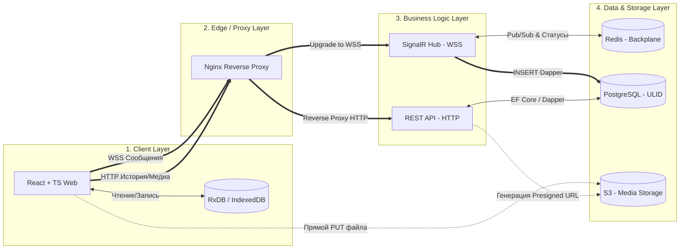

# Документация проекта «Веб-мессенджер»

## Содержание

1. [Цели и область применения](#1-цели-и-область-применения)
2. [Требования](#2-требования)
3. [Архитектура](#3-архитектура)
4. [Клиентский слой](#4-клиентский-слой)
5. [Слой маршрутизации и бизнес-логики](#5-слой-маршрутизации-и-бизнес-логики)
6. [Слой хранения данных](#6-слой-хранения-данных)
7. [Ключевые сценарии](#7-ключевые-сценарии)
8. [Безопасность и шифрование](#8-безопасность-и-шифрование)
9. [Тестирование](#9-тестирование)
10. [Структура репозитория и роли](#10-структура-репозитория-и-роли)
11. [Развёртывание](#11-развёртывание)
12. [Риски](#12-риски)
13. [Развитие проекта](#13-развитие-проекта)
14. [Статус реализации](#14-статус-реализации)

---

## 1. Цели и область применения

**Цель:** создать веб-мессенджер для безопасного общения в реальном времени без установки отдельного приложения.

**Продукт (MVP):** веб-сервис для пользователей, которым нужна быстрая и приватная текстовая переписка.

**Входит в проект:** клиентская и серверная части, проектирование БД, регистрация и авторизация, обмен сообщениями в реальном времени, хранение истории, базовая защита данных, тестирование, развёртывание.

**Не входит в MVP:** групповые чаты, звонки, сквозное шифрование (E2EE), мобильные приложения.

## 2. Требования

### Функциональные

1. Регистрация пользователя
2. Авторизация и выход
3. Редактирование профиля
4. Поиск зарегистрированных пользователей
5. Создание личных диалогов
6. Отправка текстовых сообщений
7. Получение сообщений в реальном времени
8. Хранение истории переписки
9. Просмотр истории сообщений
10. Список диалогов
11. Удаление сообщения или диалога

### Нефункциональные

1. Корректная работа при обновлении страницы (сессия, состояние диалога, позиция в истории)
2. Безопасная передача данных (HTTPS/WSS)
3. Минимальная задержка доставки
4. Поддержка современных браузеров
5. Одновременная работа множества пользователей
6. Надёжное хранение (резервное копирование, целостность БД)
7. Отзывчивый и адаптивный интерфейс
8. Разумное время отклика сервера
9. Конфиденциальность: доступ к диалогу только у его участников

## 3. Архитектура

Система разделена на четыре слоя: клиент, edge/proxy, бизнес-логика, хранение данных.



**WSS** — WebSocket Secure (WebSocket поверх TLS).

### Принятые архитектурные решения

| Решение | Обоснование |
|---------|-------------|
| Offline-First (RxDB) | Мгновенный отклик интерфейса, работа при нестабильной сети |
| SignalR + Redis backplane | Рассылка событий между несколькими инстансами бэкенда |
| ULID вместо UUID/serial | Сортируемые по времени ключи — вставка в конец индекса, меньше фрагментации |
| EF Core + Dapper (CQRS-подход) | EF — для редких операций, Dapper — для высокочастотной вставки сообщений |
| Pre-signed URL для медиа | Файлы идут напрямую в S3, бэкенд не нагружается |
| Redis для presence | Статусы «онлайн»/«печатает» не нагружают PostgreSQL |

## 4. Клиентский слой

**Стек:** React, TypeScript, RxDB (IndexedDB).

- **Optimistic UI.** При отправке сообщение сразу записывается в локальную БД и отображается. Подтверждение от сервера обновляет его статус.
- **Реальное время.** Постоянное WSS-соединение с SignalR Hub.
- **Синхронизация после офлайна.** Клиент делает HTTP-запрос дельты, передавая `LastSyncULID` — ULID последнего известного сообщения. Сервер возвращает всё более новое.
- **Медиа.** Клиент запрашивает у REST API короткоживущий Pre-signed URL и отправляет файл напрямую в S3 методом PUT.
- **Сохранение состояния** при обновлении страницы: токен сессии, открытый диалог и позиция прокрутки.

## 5. Слой маршрутизации и бизнес-логики

**Стек:** Nginx, C# .NET 10, SignalR, REST API.

### Nginx

Единая точка входа: терминирует HTTPS, проксирует обычные запросы на REST API, а запросы с `Upgrade: websocket` — на SignalR.

### Общие правила API

- Все эндпоинты, кроме `register` и `login`, требуют заголовок `Authorization: Bearer <accessToken>`.
- Идентификаторы (`id`, `userId`, `dialogId`) — ULID, строка из 26 символов. Порядок сортировки ULID совпадает с хронологическим.
- Ошибки возвращаются в формате `application/problem+json` (RFC 7807): `400` — невалидные данные, `401` — нет или неверный токен, `404` — не найдено или нет доступа, `409` — конфликт, `429` — превышен лимит запросов.
- Для чужих диалогов возвращается `404`, а не `403`, чтобы не раскрывать их существование.
- Логин и email хранятся в нижнем регистре.

### REST API

| Метод | Путь | Назначение | Ответ |
|-------|------|------------|-------|
| POST | `/api/auth/register` | Регистрация | `200` `{accessToken, expiresAt, user}`; `409` если логин или email занят |
| POST | `/api/auth/login` | Вход по логину или email | `200` `{accessToken, expiresAt, user}`; `401` при неверных данных |
| POST | `/api/auth/refresh` | Продлить сессию по действующему токену | `200` `{accessToken, expiresAt, user}` |
| POST | `/api/auth/logout` | Выход (клиент удаляет токен) | `204` |
| GET | `/api/users/me` | Свой профиль | `200` `user` |
| PUT | `/api/users/me` | Изменить `displayName`, `avatarUrl` (только http/https) | `200` `user` |
| GET | `/api/users?query=` | Поиск по префиксу логина или имени, от 2 символов, максимум 20 | `200` `user[]` |
| GET | `/api/dialogs` | Список диалогов с собеседником и последним сообщением | `200` `dialog[]` |
| POST | `/api/dialogs` | Создать диалог `{userId}`; если уже есть — вернуть существующий | `201` новый, `200` существующий |
| DELETE | `/api/dialogs/{id}` | Удалить диалог целиком (у обоих участников) | `204` |
| GET | `/api/dialogs/{id}/messages` | История и дельта (параметры ниже) | `200` `message[]` по возрастанию ULID |
| DELETE | `/api/messages/{id}` | Удалить своё сообщение (мягкое удаление) | `204`; `404` если не своё |
| POST | `/api/media/upload-url` | Получить Pre-signed URL | не реализовано |

Параметры истории сообщений:

| Параметр | Назначение |
|----------|------------|
| `after={ULID}` | Только более новые сообщения — дельта-синхронизация (`LastSyncULID`) |
| `before={ULID}` | Только более старые сообщения — подгрузка истории вверх |
| `limit` | Размер страницы, 1–100, по умолчанию 50 |

`after` и `before` нельзя указывать одновременно. Без них возвращаются последние `limit` сообщений. Удалённые сообщения в выдачу не попадают.

Формат объектов:

```
user    { id, login, displayName, avatarUrl }
message { id, clientMessageId, dialogId, senderId, text, mediaUrl, createdAt }
dialog  { id, createdAt, peer: user, lastMessage: message | null }
```

### SignalR Hub

Адрес: `/hubs/chat`. Токен передаётся в query-параметре `access_token` (для WebSocket) или в заголовке `Authorization`.

| Направление | Событие | Описание |
|-------------|---------|----------|
| клиент → сервер | `SendMessage(clientMessageId, dialogId, text)` | Отправка сообщения. Возвращает серверный ULID. Лимиты: `clientMessageId` до 64 символов, `text` 1–4000 символов |
| сервер → клиент | `MessageReceived(message)` | Новое сообщение. Приходит всем участникам диалога, включая другие устройства отправителя |
| сервер → клиент | `MessageAcked(clientMessageId, serverUlid)` | Подтверждение сохранения, только отправившему соединению |
| сервер → клиент | `MessageDeleted(dialogId, messageId)` | Сообщение удалено |
| клиент → сервер | `Typing(dialogId)` | Статус «печатает» |
| сервер → клиент | `UserTyping(dialogId, userId)` | Собеседник печатает |
| сервер → клиент | `PresenceChanged(userId, status)` | `online` / `offline` для тех, с кем есть диалоги |
| сервер → клиент | `DialogDeleted(dialogId)` | Диалог удалён одним из участников |

Ошибки хаба приходят клиенту как `HubException` с кодом в сообщении: `forbidden` (не участник диалога), `invalid_text`, `invalid_client_message_id`, `unauthorized`.

Клиент должен отсеивать собственные сообщения в `MessageReceived` по `clientMessageId`, поскольку событие приходит и отправителю.

### Идемпотентность

Каждое сообщение несёт уникальный клиентский ключ (`clientMessageId`). Если соединение моргнуло и клиент повторил отправку, сервер находит уже сохранённое сообщение с этим ключом и не создаёт дубликат. При повторе клиент получает тот же `serverUlid` и `MessageAcked`, но `MessageReceived` участникам повторно не рассылается.

### Доступ к данным (CQRS-подход)

- **EF Core** — редкие операции (профиль, смена имени, диалоги).
- **Dapper** — сверхчастая вставка сообщений и чтение истории, прямые SQL без лишних аллокаций.

## 6. Слой хранения данных

### PostgreSQL

Основное хранилище. Для таблицы сообщений используется **партиционирование** (например, по диапазону времени/ULID) и **ULID** в качестве ключа.

Предварительная модель данных (уточняется программистом БД):

```
users        (id ULID PK, login, email, password_hash, display_name, avatar_url, created_at)
dialogs      (id ULID PK, created_at)
dialog_members (dialog_id FK, user_id FK, joined_at, PRIMARY KEY (dialog_id, user_id))
messages     (id ULID PK, client_message_id, dialog_id FK, sender_id FK,
              text, media_url NULL, created_at, deleted_at NULL,
              UNIQUE (sender_id, client_message_id))
```

Особенности реализации:

- ULID хранится в колонке `varchar(26)` с коллацией `"C"`. Без побайтового сравнения порядок сортировки не совпадёт с хронологическим.
- `created_at` сообщения проставляет БД (`now()`), чтобы часы были единые для всех инстансов бэкенда.
- Уникальный индекс `(sender_id, client_message_id)` обеспечивает идемпотентность на уровне БД. При партиционировании `messages` его нужно расширить ключом партиции.
- Индекс `(dialog_id, id)` обслуживает историю и дельта-синхронизацию.
- Удаление диалога каскадно удаляет участников и сообщения; удаление сообщения — мягкое (`deleted_at`).

Резервное копирование — регулярные дампы (`pg_dump`) или WAL-архивация; периодически проверять восстановление.

### Redis

- **Backplane** SignalR — трансляция событий между инстансами сервера.
- **Presence** — эфемерные статусы «онлайн» и «печатает» с TTL (см. раздел 14: пока в памяти процесса).

### S3

Хранилище изображений и видео. Бэкенд только выдаёт Pre-signed URL; доступ к объектам ограничен.

## 7. Ключевые сценарии

### Отправка сообщения

1. Пользователь нажимает «Отправить».
2. Клиент записывает сообщение в RxDB со статусом `pending` — UI обновляется сразу.
3. Клиент отправляет `SendMessage` по WSS.
4. Hub проверяет, что пользователь состоит в диалоге, и проверяет идемпотентность.
5. Сообщение вставляется в PostgreSQL (Dapper).
6. Событие публикуется через Redis backplane всем участникам диалога.
7. Отправитель получает `MessageAcked`, статус меняется на `sent`.

### Возвращение из офлайна

1. Клиент восстанавливает WSS-соединение.
2. Запрашивает `GET /api/dialogs/{id}/messages?after={LastSyncULID}`.
3. Объединяет полученные сообщения с локальной БД.
4. Отправляет повторно все сообщения со статусом `pending` (идемпотентность защищает от дублей).

Ограничение: удаления старых сообщений в дельту не попадают, поскольку выдача идёт по ULID. Клиент получает их через событие `MessageDeleted` или при полной перезагрузке истории.

### Загрузка медиа

1. Клиент запрашивает `POST /api/media/upload-url`.
2. Бэкенд генерирует Pre-signed URL с коротким сроком жизни.
3. Клиент загружает файл напрямую в S3.
4. В сообщении сохраняется ссылка на объект.

## 8. Безопасность и шифрование

### Что реализуется в MVP

| Мера | Описание |
|------|----------|
| TLS (HTTPS/WSS) | Шифрование трафика между клиентом и сервером на уровне Nginx |
| Хеширование паролей | bcrypt (work factor 11); пароли в открытом виде не хранятся и не логируются. Пароль до 72 символов |
| Аутентификация | JWT access-токен (по умолчанию 60 минут). Refresh-токены и отзыв при выходе — запланированы |
| Авторизация | Проверка членства в диалоге при каждом чтении/записи сообщений |
| Валидация ввода | На сервере; экранирование вывода на клиенте (защита от XSS) |
| Защита от SQL-инъекций | Параметризованные запросы (EF Core, Dapper) |
| Ограничение частоты | Rate limiting на авторизацию (по умолчанию 10 запросов в минуту с IP); на отправку сообщений — запланировано |
| CORS и заголовки | Строгая политика CORS (список origin в конфигурации); CSP и HSTS — на уровне Nginx |
| Шифрование хранилищ | Шифрование диска/БД и server-side encryption в S3 |
| Секреты | Только через переменные окружения / секретницу, не в репозитории |
| Логи | Тексты сообщений и токены в логи не пишутся |

### Сквозное шифрование (E2EE)

В MVP **не реализуется.** Причины: усложняет серверный поиск и синхронизацию дельты, требует управления ключами и поддержки нескольких устройств (протокол уровня Signal), а срок проекта и размер команды ограничены. Сервер может читать содержимое сообщений, поэтому защита строится на разграничении доступа и защите инфраструктуры.

Допустимый компромисс — шифрование текста сообщения в БД на уровне приложения (AES-GCM, ключ вне БД). Решение принимается командой отдельно.

## 9. Тестирование

Тесты пишутся для обеих частей проекта; ответственный за организацию — тестировщик, но тесты к своему коду пишет каждый разработчик.

### Backend (`backend/`)

| Уровень | Что проверяем | Инструменты |
|---------|---------------|-------------|
| Unit | Бизнес-логика, валидация, выдача токена | xUnit |
| Интеграционные | REST-эндпоинты, работа с PostgreSQL, идемпотентность | WebApplicationFactory, Testcontainers (нужен Docker) |
| SignalR | Отправка/получение событий, права доступа | Microsoft.AspNetCore.SignalR.Client |

### Frontend (`frontend/`)

| Уровень | Что проверяем | Инструменты |
|---------|---------------|-------------|
| Unit | Утилиты, хуки, логика синхронизации | Vitest / Jest |
| Компонентные | Рендер и поведение компонентов | React Testing Library |
| E2E | Регистрация → поиск → диалог → сообщение | Playwright / Cypress |

### Ключевые тест-кейсы

- Регистрация и вход, невалидные данные
- Недоступность чужого диалога (проверка авторизации)
- Доставка сообщения между двумя пользователями в реальном времени
- Повторная отправка не создаёт дубликат
- Синхронизация после офлайна по `LastSyncULID`
- Сохранение сессии и позиции истории после обновления страницы
- Нагрузочный тест: множество одновременных соединений

## 10. Структура репозитория и роли

```
Messenger1/
├── backend/
│   ├── Messenger.sln
│   ├── src/Messenger.Api/     # REST API + SignalR Hub
│   └── tests/Messenger.Tests/ # unit и интеграционные тесты
├── frontend/    # отдельная папка фронтенда + тесты
├── docs/
├── README.md
└── DOCUMENTATION.md
```

| Участник | Роль | Зона ответственности |
|----------|------|----------------------|
| Шикин Алексей | Backend | REST API, SignalR, идемпотентность, интеграция с Redis/S3 |
| Юдашкин Андрей | Frontend | React-клиент, RxDB, Optimistic UI, синхронизация |
| Рудофилов Богдан | БД | Схема PostgreSQL, партиционирование, индексы, бэкапы |
| Черепанов Степан | Тестирование | План тестирования, автотесты, баг-репорты |

DevOps-задачи (CI/CD, Nginx, развёртывание) распределяются между участниками.

## 11. Развёртывание

- Сервер или облачный сервер с Docker
- Контейнеры: Nginx, backend, PostgreSQL, Redis, S3-совместимое хранилище (или внешний S3)
- Сертификат TLS (например, Let's Encrypt)
- CI/CD: сборка и прогон тестов на каждый Pull Request, автоматический деплой из `main`
- Резервное копирование БД по расписанию

Для локальной разработки `docker compose up -d` поднимает PostgreSQL, Redis и MinIO. Конфигурация бэкенда задаётся переменными окружения (см. `.env.example`).

## 12. Риски

| Риск | Меры |
|------|------|
| Нехватка времени | Строгий приоритет функций MVP, отказ от второстепенного |
| Уязвимости из-за ошибок архитектуры | Анализ рисков и безопасности до разработки, ревью кода |
| Уязвимости сторонних библиотек | Обновление зависимостей, аудит (`npm audit`, `dotnet list package --vulnerable`) |
| Недоступность сервисов для деплоя | Запасной вариант хостинга, возможность локального запуска через Docker |
| Сложность Offline-First синхронизации | Раннее прототипирование, интеграционные тесты |

## 13. Развитие проекта

- Сквозное шифрование (E2EE)
- Групповые чаты
- Статусы прочтения
- Push-уведомления
- Голосовые и видеозвонки
- Мобильные приложения

## 14. Статус реализации

Отражает состояние бэкенда; обновлять при изменениях.

| Область | Статус |
|---------|--------|
| Модели и схема БД (EF Core), миграции | Схема есть, файлы миграций ещё не созданы (в разработке схема создаётся автоматически) |
| Сохранение сообщений через Dapper, идемпотентность | Реализовано |
| SignalR Hub (отправка, подтверждение, печатает, удаление) | Реализовано |
| REST: аутентификация, профиль, поиск, диалоги, история, удаление | Реализовано |
| Redis backplane | Подключается, если задана строка подключения |
| Presence | В памяти процесса; версия на Redis с TTL — не реализована |
| Refresh-токены, отзыв токена при выходе | Не реализовано |
| Медиа (Pre-signed URL, S3) | Не реализовано |
| Rate limiting на отправку сообщений | Не реализовано |
| ForwardedHeaders за Nginx | Не реализовано (лимит по IP считается по адресу прокси) |
| Партиционирование `messages` | Не реализовано (зона ответственности БД) |
| Dockerfile бэкенда, Nginx, CI/CD | Не реализовано |
| Тесты бэкенда | Написаны; прогон на актуальной среде требует подтверждения |
